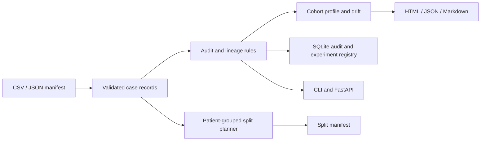

# Architecture

## Data flow

## Packages

| Module | Responsibility |
|---|---|
| `models` | Typed domain records and findings |
| `manifest` | CSV/JSON input, validation, serialization, bounded-memory hashing |
| `audit` | Rules and aggregate reports |
| `splitting` | Deterministic patient-group assignment |
| `plugins` | Entry-point discovery and custom rules |
| `storage` | SQLite migrations and run persistence |
| `config` | YAML and environment configuration |
| `observability` | JSON logs and metrics adapter seam |
| `cli` | Terminal interface |
| `api` | Optional HTTP interface |
| `integrations.dicom` | Header-only DICOM checks and keyed identifier tokens |
| `integrations.monai` | Patient-safe MONAI datalist conversion and optional transforms |
| `integrations.huggingface` | Exact-file Hub manifest retrieval |
| `provenance` | Declarative preprocessing scope checks |
| `lineage` | Parent-child graph checks for patches and derived samples |
| `profile` / `cohort_drift` | Cohort composition and categorical shift summaries |
| `evaluation` | Optional classification and segmentation metrics |
| `reporting` / `workflow` | Unified reports and shared CLI/API workflow |
| `experiments` | SQLite experiment registry with lifecycle transitions |

Dependency direction flows from interfaces into domain services. The core does not depend on FastAPI or imaging libraries. Optional libraries load only when needed.

## Data model

`CaseRecord` represents an image, series, or patch and links to an opaque `patient_id`. `split` is metadata under audit. `Finding` stores a stable code, severity, case references, and evidence. SQLite uses `schema_migrations`, `audit_runs`, `findings`, `experiments`, and `experiment_events`. Runs and experiment records include canonical digests, state, and aggregate summaries. Pixel arrays and raw DICOM header values are never copied into the run store.

## Failure behavior

Input and domain errors are typed exceptions in Python, exit codes in the CLI, and 4xx/5xx responses over HTTP. SQLite writes use transactions. Plug-in errors include the entry-point name. Audit checks return findings rather than aborting after the first issue.

## Limitations

Patient linkage is only as reliable as supplied identifiers. Cross-site patients complicate site holdout and should be resolved before splitting. Greedy stratification does not guarantee exact class balance. Results must be reviewed against the study protocol.
