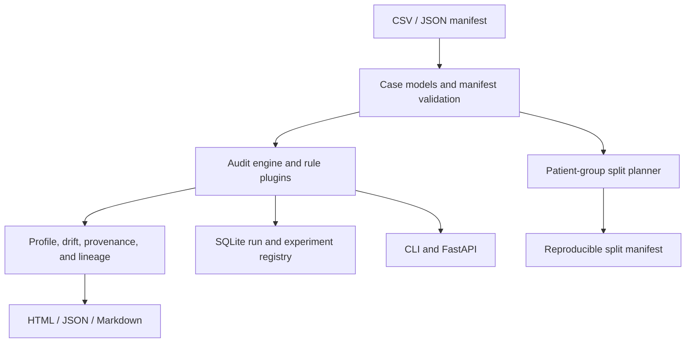

# CohortSeal technical specification

## Problem statement

Medical imaging datasets contain correlated records: slices, patches, frames, series, and repeat visits may share a patient or acquisition. Row-level splitting can place related records into training and evaluation partitions. Split files can also change across retraining or omit cases unintentionally. CohortSeal validates manifest-level group boundaries, constructs reproducible patient-grouped splits, and stores auditable run summaries.

## Target user

The primary user is a medical imaging ML engineer or research scientist in a university lab, hospital research group, or small medtech team (roughly 3 to 50 people) who works daily with DICOM/NIfTI manifests, PyTorch or MONAI preprocessing, annotation exports, and experiment evaluation. They need a pre-training check that runs locally against pseudonymous metadata without moving images to a third-party service.

## Core features

1. Validate CSV and JSON manifests with required unique case identifiers and patient groups.
2. Audit existing splits for patient overlap and supplied exact-content hashes spanning partitions.
3. Report missing stratification metadata and machine-readable errors/warnings.
4. Generate deterministic patient-group splits with optional label/site/modality stratification and a site holdout.
5. Persist manifest digests, summaries, and findings in SQLite with schema migrations.
6. Expose the same audit through CLI and optional REST API; allow third-party audit rules through Python entry points.
7. Audit declared preprocessing fit scope and derived-case lineage for patches and augmentations.
8. Profile cohort strata, compare metadata distributions, export reports, and record reproducibility-critical experiment inputs.

## Non-goals

- Clinical diagnosis, inference, or treatment recommendations.
- Proof of patient identity linkage or de-identification correctness.
- Near-duplicate detection across re-encoding, registration, crops, or augmentation.
- Automated clinical validation, prospective studies, or regulatory compliance certification.
- Image loading, annotation, training, model serving, or replacement of MONAI/nnU-Net.
- Multi-tenant hosted service, authentication, or database server support in the current implementation.

## Architecture overview



Modules depend inward on typed domain models. CLI and API are adapters. Optional FastAPI is not required to use the library or CLI.

## File and package structure

```text
.
├── .github/workflows/ci.yml
├── benchmarks/compare_splitters.py
├── docs/
│   ├── API.md
│   ├── ARCHITECTURE.md
│   ├── DESIGN_DECISION.md
│   ├── PROBLEM_VALIDATION.md
│   ├── QUICKSTART.md
│   └── SPEC.md
├── examples/
│   ├── api_client.py
│   ├── audit_and_split.sh
│   ├── create_synthetic_manifest.py
│   ├── custom_rule.py
│   ├── export_monai_datalist.py
│   ├── pipeline.json
│   └── workflow_report.py
├── src/cohortseal/
│   ├── api.py
│   ├── audit.py
│   ├── cohort_drift.py
│   ├── cli.py
│   ├── config.py
│   ├── evaluation.py
│   ├── experiments.py
│   ├── errors.py
│   ├── integrations/
│   │   ├── dicom.py
│   │   ├── huggingface.py
│   │   └── monai.py
│   ├── lineage.py
│   ├── manifest.py
│   ├── models.py
│   ├── observability.py
│   ├── plugins.py
│   ├── profile.py
│   ├── provenance.py
│   ├── reporting.py
│   ├── splitting.py
│   ├── storage.py
│   └── workflow.py
└── tests/
    ├── conftest.py
    ├── test_api.py
    ├── test_audit.py
    ├── test_config_plugins.py
    ├── test_evaluation_reporting_experiments.py
    ├── test_integrations.py
    ├── test_lineage_drift.py
    ├── test_manifest_storage.py
    ├── test_provenance_profile.py
    └── test_splitting.py
```

## Data model

- `CaseRecord`: case ID, patient ID, path reference, optional split/site/label/modality/study/series, optional SHA-256, and metadata map.
- `Finding`: stable rule code, severity, message, affected case IDs, and structured evidence.
- `SplitAssignment`: one patient group, assigned split, case count, and stratum summary.
- `DatasetManifest`: dataset name, schema version, records, source URI, and metadata.
- SQLite tables: `schema_migrations`, `audit_runs`, `findings`, `experiments`, and `experiment_events`. Run records include canonical manifest digests, counts, status, and summaries. Experiment records capture dataset, split, pipeline, model-family, redacted config, and append-only state transitions.

## API surface

### Python

- `load_manifest(path, dataset_name=None)`
- `write_manifest(cases, path)`
- `hash_file(path, chunk_size=1048576)`
- `AuditEngine(rules=None).run(cases)`
- `make_group_split(cases, fractions=None, seed=42, stratify_by=("label",), holdout_site=None)`
- `SplitPlan.apply(cases)`
- `RunStore(database).save_run(...)`, `get_run(run_id)`, `list_runs(limit=50)`
- `RuleRegistry.register(rule)`, `discover()`, and `all()`
- `CohortProfiler.profile(cases)`, `PipelineAuditor.audit(steps)`, and `LineageGraph.audit(cases)`
- `CohortDriftMonitor.compare(reference, current)`
- `ReportBuilder.render_html(payload)`, `render_markdown(payload)`, and `render_json(payload)`
- `ExperimentRegistry.create(spec)`, `get(id)`, and `transition(id, status)`
- `binary_classification_metrics(...)`, `patient_cluster_bootstrap(...)`, and `binary_segmentation_metrics(...)`

### CLI

- `cohortseal audit MANIFEST [--dataset-name] [--database] [--json] [--fail-on-warning]`
- `cohortseal split MANIFEST OUTPUT [--seed] [--holdout-site] [--stratify]`
- `cohortseal show-run RUN_ID [--database]`
- `cohortseal profile MANIFEST [--json]`
- `cohortseal pipeline-audit PIPELINE.json [--json]`
- `cohortseal report MANIFEST OUTPUT.html|.json|.md [--database]`
- `cohortseal dicom-audit FILE.dcm [...] [--json]`

### REST

- `GET /health`
- `POST /v1/audits`
- `GET /v1/audits?limit=50`
- `GET /v1/audits/{run_id}`
- `POST /v1/cohort-profile`
- `POST /v1/splits`
- `POST /v1/pipelines/audit`
- `POST /v1/cohorts/drift`

## Extension points

Plugins implement `code` and `run(tuple[CaseRecord, ...])`, return an iterable of `Finding`, and publish an entry point under `cohortseal.audit_rules`. The registry rejects duplicate codes unless replacement is explicit through the Python API. Two built-ins demonstrate label-required and site-required policies.

## Test strategy

- Unit tests cover patient overlap, duplicate hashes, deterministic splits, site holdout, invalid fractions, plugin contracts, lineage cycles, preprocessing order, cohort drift, and metrics.
- Integration tests exercise SQLite run/experiment migrations, report escaping, MONAI datalist conversion, and manifest round trips.
- End-to-end tests cover synthetic CLI and REST flows, persistence, and invalid request bounds.
- All fixtures are fabricated metadata; no clinical images or identifiers are included.

## Benchmark plan

The included deterministic benchmark compares three methods over 20,000 synthetic patient groups with four records per group: CohortSeal stratified group assignment, scikit-learn `GroupShuffleSplit`, and row-random splitting as a negative control. Metrics are median wall-clock split time over five seeds and whether any patient group crosses partitions. CohortSeal is slower than GroupShuffleSplit in the recorded container, while both preserve groups; the negative control fails boundary integrity. This shows why group-aware partitioning is required, not a runtime advantage. Re-run before publishing on other machines.

## Success criteria

- A supplied manifest either parses with unique case IDs or fails with a field-specific message.
- The audit catches every synthetic cross-split patient and exact duplicate constructed by tests.
- Repeated splits with identical data/config/seed produce the same digest and keep all patient cases together.
- Site holdout assigns the specified site to test as a whole group.
- The no-image demo runs locally and leaves an inspectable SQLite run.
- REST and CLI expose equivalent audit findings.
- Published benchmarks disclose workload, baseline, machine, versions, and limitations.
